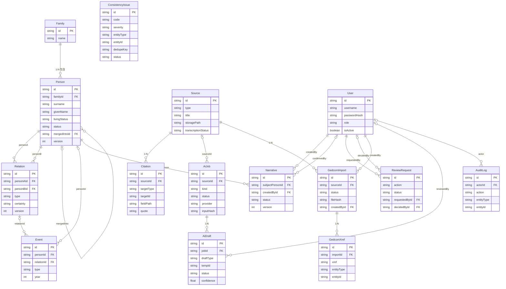

# AI 家谱编辑系统 — 数据模型 ER 图与模型评审记录

| 项目 | 内容 |
|---|---|
| 文档版本 | 1.0（2026-10-21） |
| 对应 Spec | `specs/ai-genealogy-spec.md` v1.0（校订 R2） |
| 对应实现 | `server/prisma/schema.prisma`（15 个模型） |
| 工作包 | 3.1.3 ER 图、数据字典与模型评审记录 |
| 文档状态 | 已完成，待审阅 |

> 本文件与 `docs/data-dictionary.md` 共同构成 3.1.3 的交付物。字段级类型、必填、默认值、敏感级别与约束以数据字典为准；本文件聚焦实体关系、外键、删除语义、索引和设计评审结论。

## 1 范围与建模约定

1. 数据库为 SQLite，ORM 为 Prisma 6；MVP 为单家族、单机部署。
2. 所有模型主键均为 `String @id @default(cuid())`；不使用自增整数主键，避免导入/合并时标识冲突。
3. SQLite 不支持 Prisma 原生枚举、`Json` 与标量数组，因此：
   - 枚举值以 `String` 存储，允许值由 `shared/src/constants/enums.ts` 与 zod Schema 双重约束；
   - 结构化 JSON 以 `String`（TEXT）存储，字段名以 `Json` 结尾，边界处做序列化/反序列化与校验；
   - 日期不使用数组，部分日期展开为 `year/month/day/dateText/precision/approximate/calendar` 扁平列。
4. 人物删除为软删除（`status=DELETED` 且 `deletedAt` 非空）；审计日志只追加。
5. 关系、事件、来源、引用、审核、AI 任务等不提供物理删除接口；关系与引用的物理删除只发生在已批准的删除审核事务中。
6. 敏感级别 L0–L3 的定义与字段标注见 `docs/data-dictionary.md` 第 3 章；本文件不重复逐字段标注。
7. 所有时间戳为 UTC 存储、前端按本地时区展示；`createdAt`/`updatedAt` 为系统元数据，不接受客户端直接写入。

## 2 ER 图

> 图中仅展示主键、外键与关键业务字段；完整字段清单见 `docs/data-dictionary.md` 第 5 章。虚线逻辑引用（Citation、AuditLog 等）无法用数据库外键表达，见 3.2 节。

## 3 外键与关系清单

### 3.1 物理外键（schema 中的 `@relation`）

| 源模型 | 关系字段 | 目标模型 | 基数 | 可空 | onDelete | 业务说明 |
|---|---|---|---|---|---|---|
| Person | family | Family | N:1 | 否 | Restrict | 人物必须属于一个家族；MVP 仅一个家族 |
| Person | mergedInto | Person | N:1（自关联） | 是 | SetNull | 合并后指向保留者；MERGED 状态配合使用 |
| Relation | personA | Person | N:1 | 否 | Restrict | 亲子关系中 A=父/母；配偶关系 A/B 规范化 |
| Relation | personB | Person | N:1 | 否 | Restrict | 亲子关系中 B=子女；禁止自环 |
| Event | person | Person | N:1 | 是 | Restrict | 个人事件；与 relation 至少填一个（应用层保证） |
| Event | relation | Relation | N:1 | 是 | Restrict | 婚姻/离婚等关系事件；与 person 至少填一个 |
| Citation | source | Source | N:1 | 否 | Restrict | 字段级引用必须指向来源 |
| AiJob | source | Source | N:1 | 是 | SetNull | 来源被删除时保留任务历史，sourceId 置空 |
| AiDraft | job | AiJob | N:1 | 否 | Restrict | 草稿必须属于一个 AI 任务 |
| AiDraft | reviewedBy | User | N:1 | 是 | SetNull | 审核人账号删除/停用后保留草稿 |
| Narrative | subjectPerson | Person | N:1 | 否 | Restrict | 叙事主体人物 |
| Narrative | createdBy | User | N:1 | 否 | Restrict | 生成者；已确认叙事的追责依据 |
| Narrative | confirmedBy | User | N:1 | 是 | SetNull | 确认者账号删除后保留确认时间 |
| ReviewRequest | requestedBy | User | N:1 | 否 | Restrict | 发起人；发起人可撤回 |
| ReviewRequest | decidedBy | User | N:1 | 是 | SetNull | 审批人；保留决定记录 |
| AuditLog | actor | User | N:1 | 是 | SetNull | 账号删除后审计仍可追溯，actorRole 为快照 |
| GedcomImport | source | Source | N:1 | 否 | Restrict | 导入批次必须对应一个 GEDCOM 来源 |
| GedcomImport | createdBy | User | N:1 | 否 | Restrict | 导入操作人 |
| GedcomXref | gedcomImport | GedcomImport | N:1 | 否 | Cascade | 批次删除时清理映射；正常流程不删除批次 |

### 3.2 逻辑/多态引用（无数据库外键）

| 模型 | 字段 | 可指向 | 完整性保证 | 说明 |
|---|---|---|---|---|
| Citation | targetType + targetId | Person / Relation / Event | 服务层校验目标存在、`targetType` 属于 `CITATION_TARGET_TYPES`；按 `(targetType, targetId)` 建索引 | 字段级引用必须绑定 `fieldPath` 与 `quote`；删除关系时先清理引用并写审计快照 |
| AiDraft | appliedEntityType + appliedEntityId | Person / Relation / Event | 仅接受事务写入，写后不可变更 | 记录草稿落地后的正式实体，便于追溯 |
| ConsistencyIssue | entityType + entityId | Person / Relation / Event 等被校验实体 | 规则执行器按规则码写入；按 `(entityType, entityId)` 建索引 | 实体软删除后问题由复检自动解决；不做级联删除 |
| AuditLog | entityType + entityId | 任意业务实体 | 写入时由服务层填充；只追加 | 审计日志不依赖外键，避免删除实体导致审计丢失 |
| GedcomXref | entityType + entityId | Person / Family / Relation / Event | 仅由导入提交事务写入；唯一键为 `(importId, xref)` | 用于幂等与往返导出；不随实体删除级联 |
| ReviewRequest | payloadJson / expectedVersionsJson | Person / Relation 等 | 服务层解析并校验；审批前重查版本 | 版本快照保存在 JSON 中，版本变化返回 409 |
| Narrative | contentJson.sentences[].factRefs | Citation / 字段 / 事件 | 服务端构建事实包并解析引用；无有效 factRef 不得确认 | 模型返回的伪引用被丢弃 |

## 4 删除与生命周期语义

| 实体 | 删除方式 | 级联/保留策略 | 默认可见性 |
|---|---|---|---|
| Person | 软删除（`status=DELETED`、`deletedAt`） | 关系、事件、引用保留；合并来源人物改为 `MERGED` | 默认查询仅 `ACTIVE`；审计与合并追溯可查 |
| Relation | 仅通过 DELETE_RELATION 审核物理删除 | 先删除该关系的 Citation，审计保存快照；关联 Event 需先处理 | 默认可见 |
| Event | 随人物/关系编辑删除，写审计 | 仅删除事件本身；引用由服务层同步处理 | 默认可见 |
| Family | MVP 不提供删除 | Person.family 为 Restrict | 默认可见 |
| Source | MVP 不提供删除 | Citation/AiJob/GedcomImport 为 Restrict 或 SetNull | 按角色裁剪 |
| Citation | 随字段/关系/实体删除清理 | 删除写审计；quote 不落日志明文以外的地方 | 随目标遮罩 |
| AiJob / AiDraft | 不删除，保留任务历史 | 失败任务可重试为新任务；草稿只改状态 | 仅 ADMIN/EDITOR |
| Narrative | 不删除；重新生成产生新记录 | CONFIRMED 只读；DRAFT 可编辑 | VIEWER 无权限 |
| ReviewRequest | 不删除；状态终结后保留 | 撤回为 CANCELLED；审批记录永久保留 | ADMIN/REVIEWER |
| AuditLog | 不可删除、不可更新 | SQLite 触发器（2.1.3）阻止 UPDATE/DELETE | 仅 ADMIN/REVIEWER 查询 |
| GedcomImport | 不删除 | GedcomXref 随批次 Cascade；已提交批次保留 | ADMIN/EDITOR |
| GedcomXref | 随批次 Cascade | 不单独删除 | 导入追溯 |
| User | 不删除，`isActive=false` 禁用 | 关键外键 Restrict；可空外键 SetNull | ADMIN 管理 |

## 5 索引与唯一约束清单

> 所有模型的主键 `id` 均为 `String @id @default(cuid())`，不在此表重复列出。定义的规范化形式与 `server/prisma/schema.prisma` 一致（忽略空格）。

| 模型 | 定义 | 类型 | 用途 |
|---|---|---|---|
| User | `@unique(username)` | 唯一 | 登录名唯一 |
| User | `@@index([role])` | 普通 | 按角色筛选账号 |
| Person | `@@index([familyId, status])` | 普通 | 家族内默认 ACTIVE 列表/树查询 |
| Person | `@@index([surname, givenName])` | 普通 | 姓名检索（前缀/排序） |
| Person | `@@index([alias])` | 普通 | 别名检索 |
| Person | `@@index([generation])` | 普通 | 世代筛选 |
| Person | `@@index([branch])` | 普通 | 支系筛选 |
| Person | `@@index([birthYear])` | 普通 | 出生年筛选/统计 |
| Person | `@@index([deathYear])` | 普通 | 死亡年筛选/统计 |
| Person | `@@index([deletedAt])` | 普通 | 软删除审计查询 |
| Relation | `@@unique([type, personAId, personBId])` | 唯一 | 防止同类型同方向重复关系 |
| Relation | `@@index([personAId, type])` | 普通 | 按 A 端 + 关系类型查关系 |
| Relation | `@@index([personBId, type])` | 普通 | 按 B 端 + 关系类型查关系 |
| Relation | `@@index([type])` | 普通 | 按关系类型筛选 |
| Event | `@@index([personId, type])` | 普通 | 人物事件列表 + 类型筛选 |
| Event | `@@index([relationId, type])` | 普通 | 关系事件列表 + 类型筛选 |
| Event | `@@index([type])` | 普通 | 按事件类型筛选 |
| Event | `@@index([year])` | 普通 | 按年份筛选/排序 |
| Source | `@@index([fileHash])` | 普通 | 重复文件检测 |
| Source | `@@index([type])` | 普通 | 按来源类型筛选 |
| Source | `@@index([createdAt])` | 普通 | 来源列表时间排序 |
| Citation | `@@index([sourceId])` | 普通 | 按来源查引用 |
| Citation | `@@index([targetType, targetId])` | 普通 | 按目标实体查引用 |
| Citation | `@@index([fieldPath])` | 普通 | 按字段路径查引用 |
| AiJob | `@@index([sourceId])` | 普通 | 按来源查任务 |
| AiJob | `@@index([status])` | 普通 | 任务队列/轮询 |
| AiJob | `@@index([inputHash])` | 普通 | 重复抽取提示 |
| AiJob | `@@index([createdAt])` | 普通 | 任务历史排序 |
| AiDraft | `@@unique([jobId, draftType, tempId])` | 唯一 | 同一任务内 tempId 唯一，支持关系解析与幂等 |
| AiDraft | `@@index([jobId, status])` | 普通 | 按任务 + 状态列草稿 |
| AiDraft | `@@index([status])` | 普通 | 待审草稿统计 |
| AiDraft | `@@index([reviewedById])` | 普通 | 按审核人查草稿 |
| Narrative | `@@index([subjectPersonId])` | 普通 | 按主体人物查叙事 |
| Narrative | `@@index([status])` | 普通 | DRAFT/CONFIRMED 筛选 |
| Narrative | `@@index([createdById])` | 普通 | 按生成人查询 |
| Narrative | `@@index([confirmedById])` | 普通 | 按确认人查询 |
| ConsistencyIssue | `@unique(dedupeKey)` | 唯一 | 同一问题只保留一行 |
| ConsistencyIssue | `@@index([status, severity, lastSeenAt])` | 普通 | 问题列表默认筛选并按最近发现排序 |
| ConsistencyIssue | `@@index([code])` | 普通 | 按规则码统计 |
| ConsistencyIssue | `@@index([entityType, entityId])` | 普通 | 查看实体问题 |
| ConsistencyIssue | `@@index([lastSeenAt])` | 普通 | 复检与最近发现排序 |
| ReviewRequest | `@@index([status])` | 普通 | 待审列表 |
| ReviewRequest | `@@index([action])` | 普通 | 按动作筛选 |
| ReviewRequest | `@@index([requestedById])` | 普通 | 按发起人查询 |
| ReviewRequest | `@@index([createdAt])` | 普通 | 审核历史排序 |
| AuditLog | `@@index([createdAt])` | 普通 | 审计时间查询 |
| AuditLog | `@@index([actorId, createdAt])` | 普通 | 按操作人 + 时间查询 |
| AuditLog | `@@index([action, createdAt])` | 普通 | 按动作 + 时间查询 |
| AuditLog | `@@index([entityType, entityId, createdAt])` | 普通 | 按实体追溯 + 时间排序 |
| GedcomImport | `@@index([fileHash])` | 普通 | 同文件幂等检查 |
| GedcomImport | `@@index([status])` | 普通 | 批次状态筛选 |
| GedcomImport | `@@index([sourceId])` | 普通 | 按来源查批次 |
| GedcomImport | `@@index([createdById])` | 普通 | 按操作人查询 |
| GedcomXref | `@@unique([importId, xref])` | 唯一 | 同一批次 xref 唯一 |
| GedcomXref | `@@index([entityType, entityId])` | 普通 | 反查实体来源 xref |

## 6 设计评审记录

评审人：技术负责人；评审对象：3.1.1 schema 与 3.1.2 日期/状态规范。结论均不要求在本包修改表结构；如需变更，先更新 Spec 并获得用户授权。

| 编号 | 评审问题 | 结论 | 残留风险与后续归属 |
|---|---|---|---|
| R-01 | SQLite 不支持原生枚举、JSON、数组 | 接受：枚举用 String + 共享常量 + zod；JSON 用 TEXT；日期扁平列 | 数据库层不做值域校验，错误值可能绕过应用写入；所有写入必须经过服务层 Schema，3.2.2/3.3.1 落实 |
| R-02 | Citation、AuditLog、ConsistencyIssue、GedcomXref 使用多态 targetId，无法建外键 | 接受：应用层校验目标存在性，按 `(targetType, targetId)` 建索引；删除实体时由服务层清理或保留审计 | 可能出现孤儿引用；2.2.3/3.4.1 增加巡检与测试 |
| R-03 | Event 要求“personId 与 relationId 至少一个”，SQLite/Prisma schema 未建 CHECK | 接受：由 zod 与服务层保证；不新增数据库触发器 | 直接 SQL 写入可绕过；仅内部服务访问数据库，风险可接受 |
| R-04 | AuditLog 不可变性需要 SQLite 触发器，不在 3.1.1 迁移内 | 接受：触发器归 2.1.3；本包只保证没有 updatedAt、无修改接口 | 2.1.3 完成前审计仅靠应用层约束；列入该包验收 |
| R-05 | Person 合并使用自关联 mergedInto，且软删除与关系唯一约束叠加 | 接受：合并后源人物 `MERGED`，默认查询过滤；关系去重与重指向在审批事务内完成；版本匹配后执行 | 需保证合并时不会产生自环/重复关系；2.2.4 事务测试覆盖 |
| R-06 | Source.fileHash 未设唯一，同一文件可产生多个来源 | 接受：导入/上传时提示重复；GedcomImport 另以“已提交文件哈希”阻止重复导入；Source 允许多次引用同一底稿 | 可能出现重复来源；2.2.3/2.5.2 做提示与测试，不在本包加唯一约束 |
| R-07 | GedcomImport.fileHash 未设唯一，失败/取消的批次可重试 | 接受：幂等只针对 COMMITTED 批次；FAILED/CANCELLED 允许重新导入 | 同一文件可有多个历史批次，属预期；2.5.2 固化查询条件 |
| R-08 | ReviewRequest 无 EXECUTING 状态，审批与执行同事务 | 接受：按 Spec 的 `PENDING → APPROVED →（事务执行）`；执行失败回滚并保持 PENDING | 缺少持久化错误字段，错误写入 AuditLog 与服务日志；若答辩要求请求内错误详情，需另立变更 |
| R-09 | 已确认叙事只读、草稿可编辑，但版本字段仅 Narrative 有 | 接受：Narrative.version 用于草稿编辑的乐观锁；CONFIRMED 后服务层拒绝 PATCH；重新生成新建记录 | 只读性靠服务层，数据库无法阻止直接更新；2.4.4 测试覆盖 |
| R-10 | 姓名模糊检索使用 contains，B-tree 索引对前导通配符帮助有限 | 接受：MVP 数据量 1,000–10,000，`surname/givenName` 索引仍服务前缀与排序；不引入 FTS/额外依赖 | 大数据量下检索变慢；3.2.2 基准测试记录，若超阈值再评估 FTS |
| R-11 | livingStatus 与 status 两个状态维度易混淆 | 接受：`livingStatus` 只表示在世/已故/未知，服务隐私遮罩；`status` 只表示记录生命周期 ACTIVE/MERGED/DELETED；禁止互相推导 | 新增人物默认 LIVING；死亡事实需用户确认；3.5.1 做遮罩与确认测试 |
| R-12 | 过度依赖 JSON TEXT（payload/details/content）导致查询与约束弱 | 接受：JSON 仅用于任务快照、差异、叙事内容等非检索字段；不把需筛选的业务字段放入 JSON | 需 zod 严格校验并在读取时处理损坏 JSON；3.3.1 定义 Schema |
| R-13 | 审核请求的 expectedVersionsJson 与实体版本可能不一致 | 接受：审批前解析并重查所有期望版本，任一变化返回 409 且保持 PENDING；前端重新预览 | 并发冲突需要用户重试；2.6.1 状态机与版本测试覆盖 |
| R-14 | ConsistencyIssue 的 dedupeKey 唯一，但问题复现/忽略后状态语义需明确 | 接受：IGNORED 复检保持忽略；RESOLVED 同一键再次检出时重新 OPEN 并更新 lastSeenAt；不新增状态 | 复检执行器需区分“未再出现”和“再次出现”；3.4.1 实现并测试 |
| R-15 | User 无软删除，账号禁用与历史数据关联 | 接受：禁用 `isActive=false`，不删除账号；可空外键 SetNull，关键外键 Restrict | 禁用后历史审计仍保留 actorRole 快照；2.1 认证与权限测试覆盖 |

**评审结论**：15 个模型覆盖 Spec 2.4.1 的全部实体；外键、唯一约束、索引满足 MVP 查询与幂等需求；已知限制均有明确归属包，不需要在 3.1.3 修改 schema。

## 7 与 schema 的一致性检查

- 自动化检查：`server/tests/docs.spec.ts`，随 `npm test` 执行。
- 检查内容：
  1. `docs/data-dictionary.md` 的模型集合与字段集合和 `schema.prisma` 完全一致（含可选性/类型）；
  2. 每个字段均有 L0–L3（或条件级别）标注；
  3. 3.1 节物理外键清单与 schema 的 `@relation(fields: ...)` 一一对应，`onDelete` 一致；
  4. 第 5 章索引/唯一约束清单与 schema 的 `@unique`、`@@unique`、`@@index` 完全一致；
  5. ER 图包含全部 15 个模型；
  6. 状态机章节覆盖所有枚举状态字段，且允许值与 `shared/src/constants/enums.ts` 一致；
  7. 枚举字典完整列出 26 个常量组与全部允许值。
- 人工检查：ER 关系基数、删除语义、评审结论与 Spec 2.4.2、2.6.3、2.7.4、2.7.5、2.12 一致。
